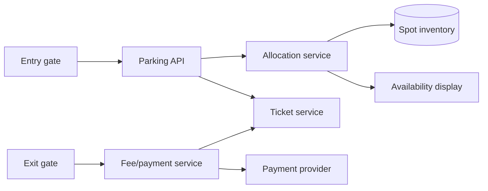
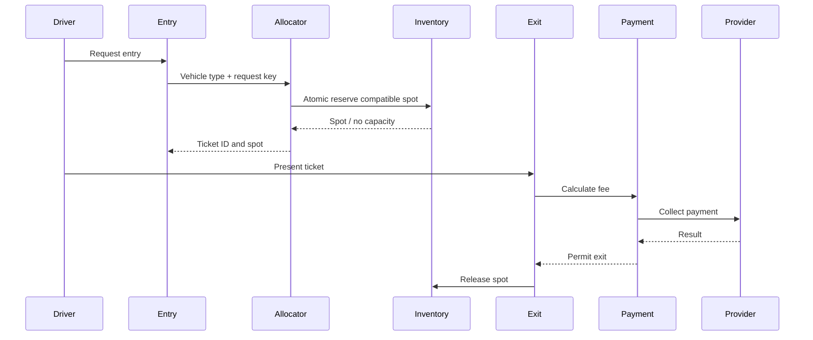
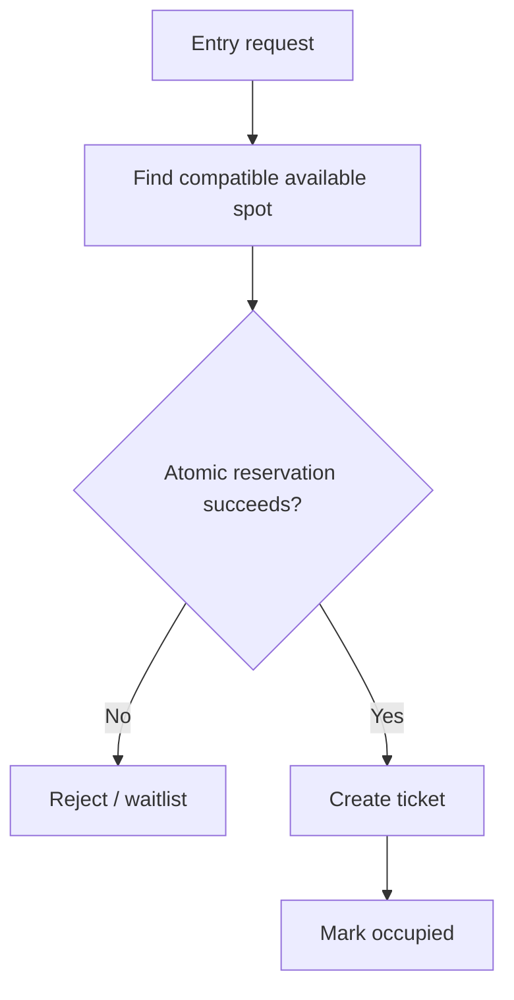

# Architecture and Diagrams

## Visual explainer

See [the enhanced visual architecture, critical sequence, failure/recovery flow, AWS/GCP starter mapping and interview walkthrough](visual_explainer.md). Editable Archify source: [archify/parking-lot.architecture.json](archify/parking-lot.architecture.json).
