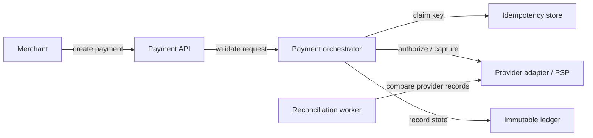
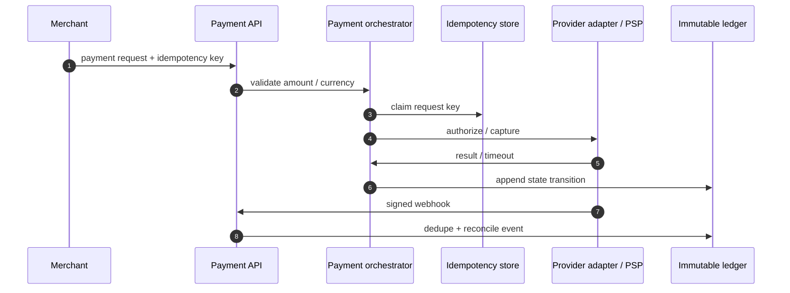
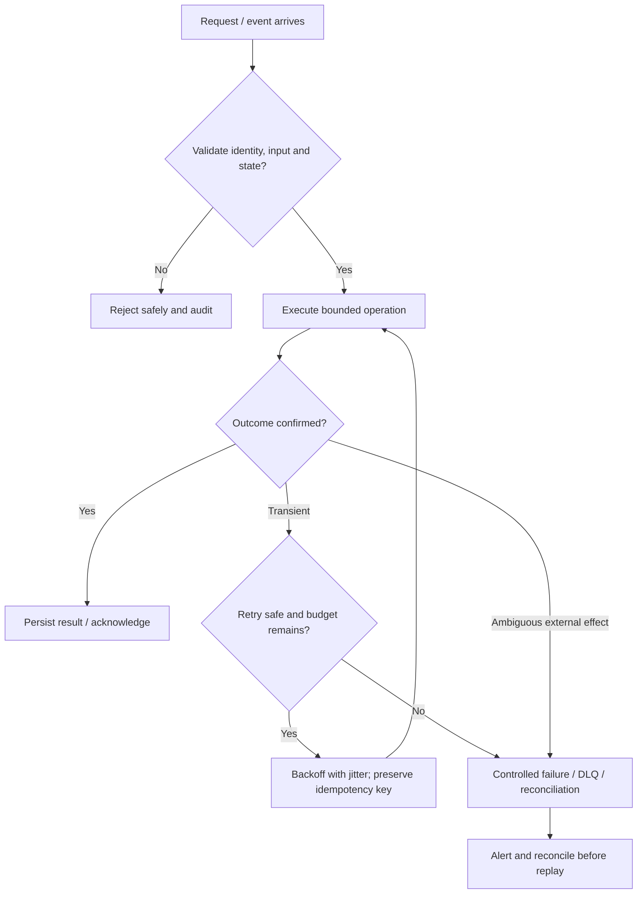

# Payment Processing — Visual Architecture Explainer

> Conceptual HLD based on this repository's design notes. Confirm workload assumptions, service semantics and deployment choices before implementation.

## 1. System architecture

Follow the primary request path first. Storage, policy, queue and telemetry are supporting boundaries; they are not interchangeable.

## 2. Critical interaction

## 3. Failure and recovery

## 4. Core invariants

- Every external mutation has an idempotency key and durable state transition.
- Ledger entries are append-only and balanced per accounting model.
- Unknown provider outcomes are reconciled, not blindly retried.

## 5. Architecture decisions to defend

- Clarify authorization/capture/refund lifecycle, currencies, merchant scope, compliance boundary and latency/availability needs.
- Define payment state machine, idempotency scope, provider adapter contract and immutable ledger entries.
- Walk request → idempotency claim → PSP call → durable state → signed webhook → reconciliation.

| Concern | AWS starting point | GCP starting point |
|---|---|---|
| Compute / API | API Gateway + ECS/Lambda as appropriate | API Gateway / Cloud Load Balancing + Cloud Run/GKE |
| Durable state | RDS/Aurora or DynamoDB based on access pattern | Cloud SQL/Spanner/Firestore based on access pattern |
| Async work | SQS/SNS/EventBridge/Kinesis as needed | Pub/Sub/Eventarc as needed |
| Operations | CloudWatch, X-Ray, IAM, Secrets Manager | Cloud Logging/Monitoring/Trace, Cloud IAM, Secret Manager |

These are starter mappings, not exact equivalents. Choose services from required consistency, ordering, retention, latency, regional scope and operational constraints.

## 6. Senior interview walkthrough (10 minutes)

### 0:00–1:00 — Frame the problem
Clarify authorization/capture/refund lifecycle, currencies, merchant scope, compliance boundary and latency/availability needs.

### 1:00–2:00 — Requirements and invariants
Define payment state machine, idempotency scope, provider adapter contract and immutable ledger entries.

### 2:00–4:00 — Draw and narrate the architecture
Walk request → idempotency claim → PSP call → durable state → signed webhook → reconciliation.

### 4:00–6:00 — Walk the critical path
Treat timeout-after-provider-success as ambiguous; query/reconcile before retrying external effects.

### 6:00–8:00 — Failure, recovery and operations
Failure cases: duplicate request, duplicate webhook, PSP outage, partial capture, refund race and settlement mismatch.

### 8:00–9:00 — Trade-offs and alternatives
Trade-offs: synchronous authorization vs async confirmation; provider routing vs complexity; ledger correctness vs eventual UI status.

### 9:00–10:00 — Close with measurable signals
Name the SLOs and operational signals that demonstrate correctness and capacity: user-visible latency/error rate, saturation, queue age/lag where applicable, retry/duplicate rate, and domain success metrics. State what would trigger a redesign rather than claiming unlimited scale.

## 7. Follow-up questions to rehearse

- What if PSP succeeds but response times out?
- How do you handle duplicate webhooks?
- How do you reconcile settlement?
- How do you prevent double capture?

## Archify source

Editable Archify diagram IR: archify/payment-processing.architecture.json. Generate the interactive HTML with the Archify skill/CLI from the repository root. The Mermaid diagrams above render directly on GitHub.
