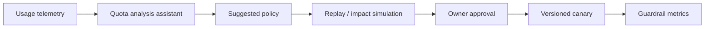

# AI / FDE Implementation

AI can analyze quota telemetry and suggest policy changes. Enforcement remains deterministic and server-side.

Never let model output directly alter quotas. Evaluate false throttles, abuse containment, tenant fairness and latency.