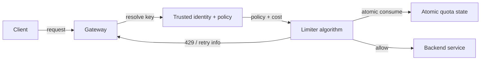
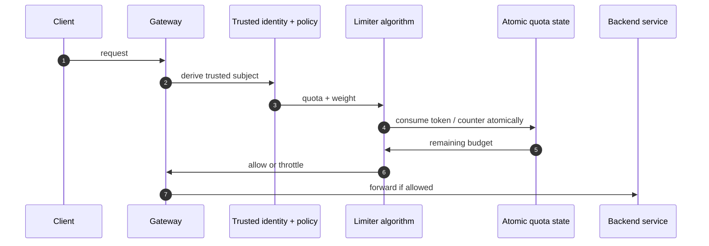
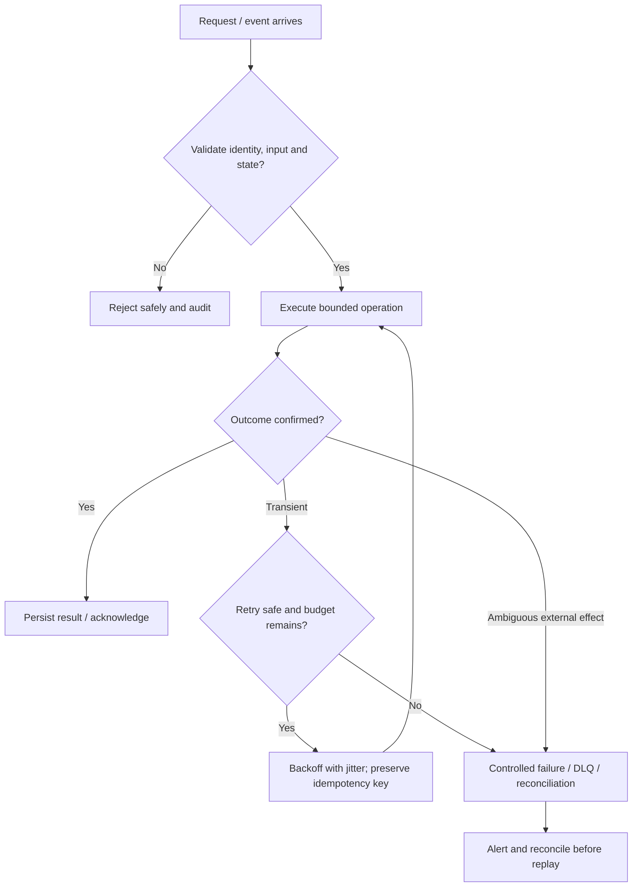

# Rate Limiter — Visual Architecture Explainer

> Conceptual HLD based on this repository's design notes. Confirm workload assumptions, service semantics and deployment choices before implementation.

## 1. System architecture

Follow the primary request path first. Storage, policy, queue and telemetry are supporting boundaries; they are not interchangeable.

## 2. Critical interaction

## 3. Failure and recovery

## 4. Core invariants

- Quota keys derive from trusted identity, not arbitrary client fields.
- Consume/check is atomic for the selected algorithm.
- Fail-open/closed behavior is policy-specific and observable.

## 5. Architecture decisions to defend

- Clarify key dimensions (user, tenant, API key, IP), burst, sustained rate, weighted cost and fairness.
- Compare token bucket, leaky bucket, fixed window and sliding window; justify chosen semantics.
- Walk trusted key derivation → policy lookup → atomic consume → allow or 429 with retry metadata.

| Concern | AWS starting point | GCP starting point |
|---|---|---|
| Compute / API | API Gateway + ECS/Lambda as appropriate | API Gateway / Cloud Load Balancing + Cloud Run/GKE |
| Durable state | RDS/Aurora or DynamoDB based on access pattern | Cloud SQL/Spanner/Firestore based on access pattern |
| Async work | SQS/SNS/EventBridge/Kinesis as needed | Pub/Sub/Eventarc as needed |
| Operations | CloudWatch, X-Ray, IAM, Secrets Manager | Cloud Logging/Monitoring/Trace, Cloud IAM, Secret Manager |

These are starter mappings, not exact equivalents. Choose services from required consistency, ordering, retention, latency, regional scope and operational constraints.

## 6. Senior interview walkthrough (10 minutes)

### 0:00–1:00 — Frame the problem
Clarify key dimensions (user, tenant, API key, IP), burst, sustained rate, weighted cost and fairness.

### 1:00–2:00 — Requirements and invariants
Compare token bucket, leaky bucket, fixed window and sliding window; justify chosen semantics.

### 2:00–4:00 — Draw and narrate the architecture
Walk trusted key derivation → policy lookup → atomic consume → allow or 429 with retry metadata.

### 4:00–6:00 — Walk the critical path
Discuss distributed state, hot keys, cardinality, multi-region limits and local fallback.

### 6:00–8:00 — Failure, recovery and operations
Failure cases: limiter store outage, clock skew, stale policy, hot tenant and client retry storm.

### 8:00–9:00 — Trade-offs and alternatives
Trade-offs: exact global quota vs latency/availability; approximate local limits vs overshoot.

### 9:00–10:00 — Close with measurable signals
Name the SLOs and operational signals that demonstrate correctness and capacity: user-visible latency/error rate, saturation, queue age/lag where applicable, retry/duplicate rate, and domain success metrics. State what would trigger a redesign rather than claiming unlimited scale.

## 7. Follow-up questions to rehearse

- How do you enforce global limits across regions?
- What happens if Redis is down?
- How do you handle weighted requests?
- How do you prevent noisy-neighbor starvation?

## Archify source

Editable Archify diagram IR: archify/rate-limiter.architecture.json. Generate the interactive HTML with the Archify skill/CLI from the repository root. The Mermaid diagrams above render directly on GitHub.
