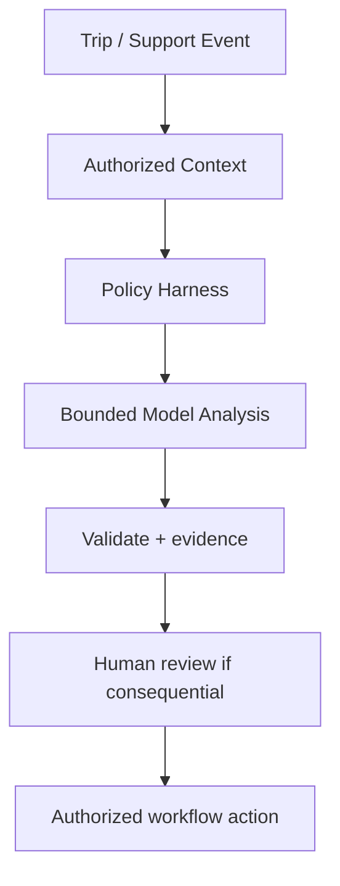

# AI / FDE Implementation — Ride-Hailing

AI can support ETA explanation, support summaries and fraud-risk signals. Dispatch, fare calculation, driver assignment and trip transitions remain deterministic.

Prompt defines output schema; Context uses authorized trip/location evidence; Harness checks scope, privacy and tool permissions; Loop is bounded and verifies evidence; Graph handles safety/dispute review and human approval.

Do not let model output directly assign drivers, change prices or close safety cases. Location data is sensitive; minimize retention and redact telemetry.
