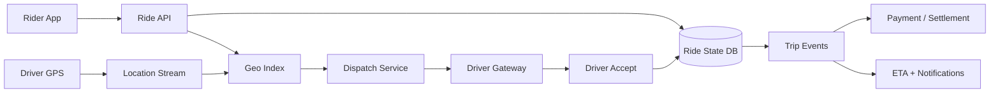
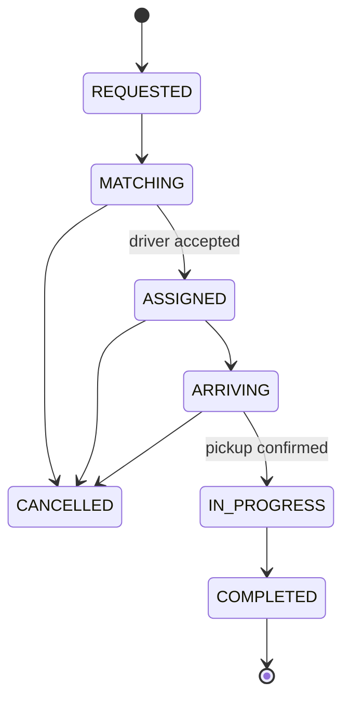

# Uber / Rapido-Style Ride-Hailing

## Scope
Rider/driver onboarding, quote, geospatial discovery, dispatch, trip lifecycle, live location, payment, cancellation and safety.

## Architecture

## Critical flow
Request → quote → candidate drivers from geo cells → offer with expiry → atomic accept/CAS assignment → trip state transitions → location updates → completion and settlement. Dispatch must tolerate stale GPS and duplicate accept commands.

## Data model
Rider, Driver, Vehicle, LocationPing, RideRequest, Offer, Trip(state/version), FareQuote(pricingVersion), Payment, SafetyIncident. Store current location as TTL/stream data; canonical trip state is transactional.

## Failure modes
Double acceptance, stale coordinates, driver disconnect, cancellation race, payment timeout, out-of-order GPS and safety escalation. Use compare-and-set, offer leases, event sequence, reconciliation and explicit pending payment states.

## Trade-offs
Sequential vs batch offers; GPS update frequency vs battery/network; geo cell size vs candidate precision; surge responsiveness vs pricing stability; regional dispatch vs global coordination.

## Interview walkthrough
Clarify city density, peak rides/min, pickup SLA, location cadence, trip state and payment guarantees. Explain geospatial candidate search, dispatch lease/accept CAS, trip state machine, location stream, payment saga and safety.

## Visual explainer

## AI/FDE
AI can assist ETA explanation, support triage and fraud-risk signals. Prompt defines task; Context uses authorized trip facts; Harness gates access and actions; Loop is bounded; Graph routes disputes/safety cases to human review. Never let model directly assign drivers or alter fares.
