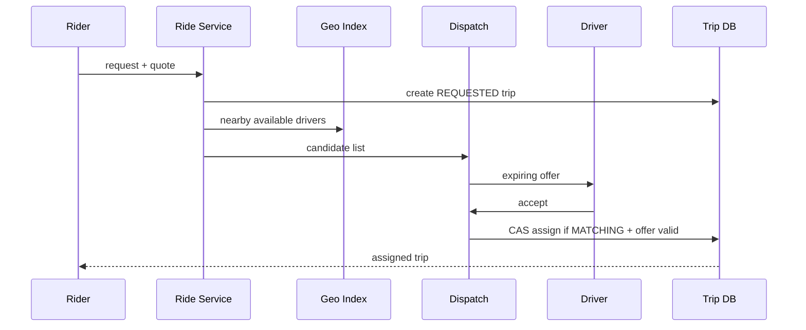

# Architecture — Ride-Hailing

Request API persists trip request and quote; geo service indexes fresh driver locations by cell; dispatch offers to candidates; driver gateway delivers offer; assignment uses conditional update on trip version/status; location stream updates ETA; trip events drive payment, notifications and analytics.

Partition by city/geo cell for discovery; trip ownership by tripId. Keep GPS ingestion separate from canonical trip state. Use regional dispatch cells and backpressure during demand spikes.
