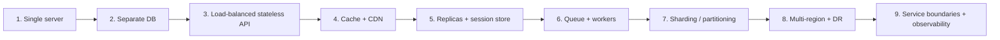
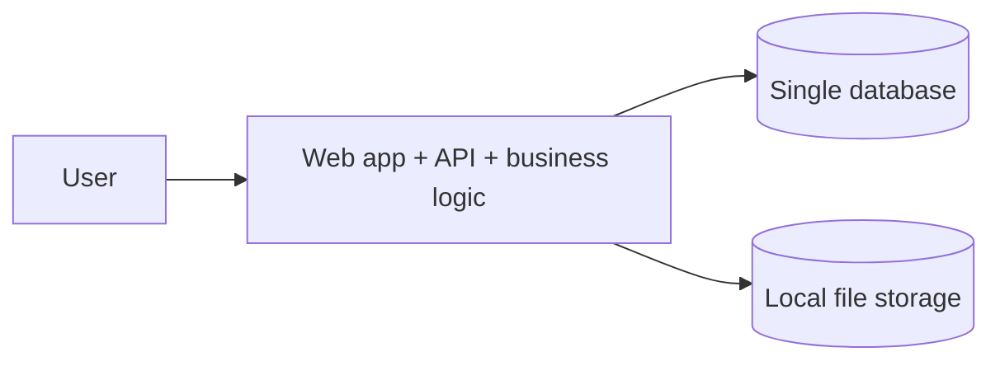
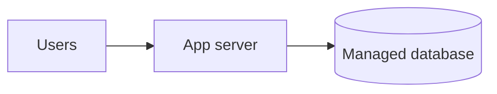
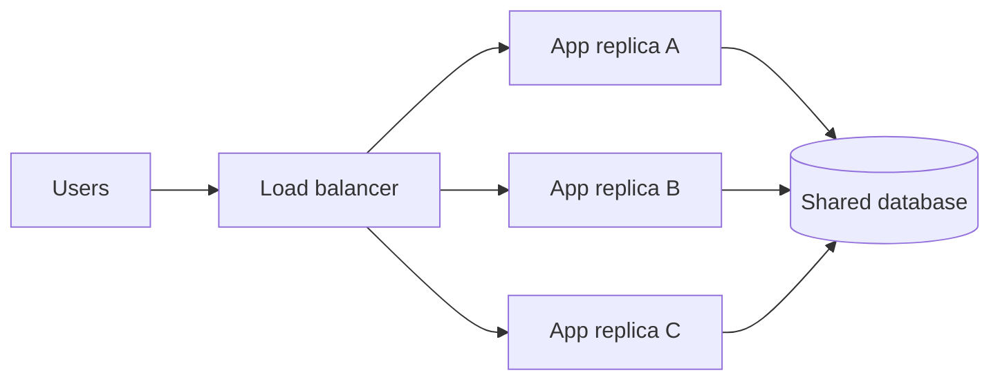
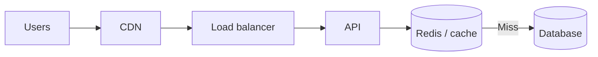
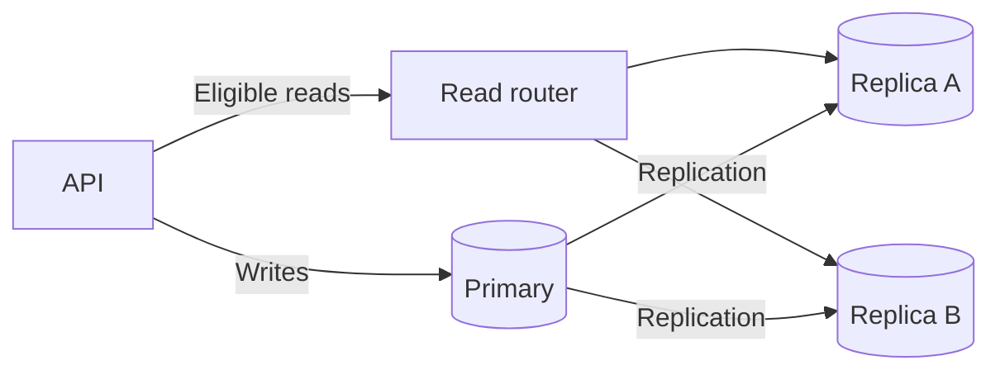
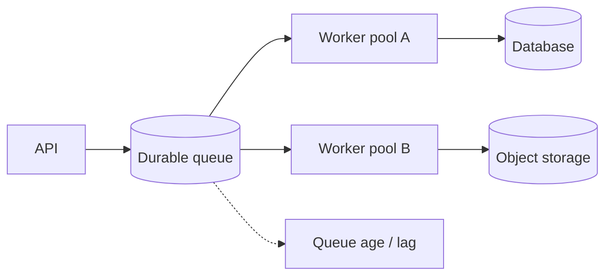
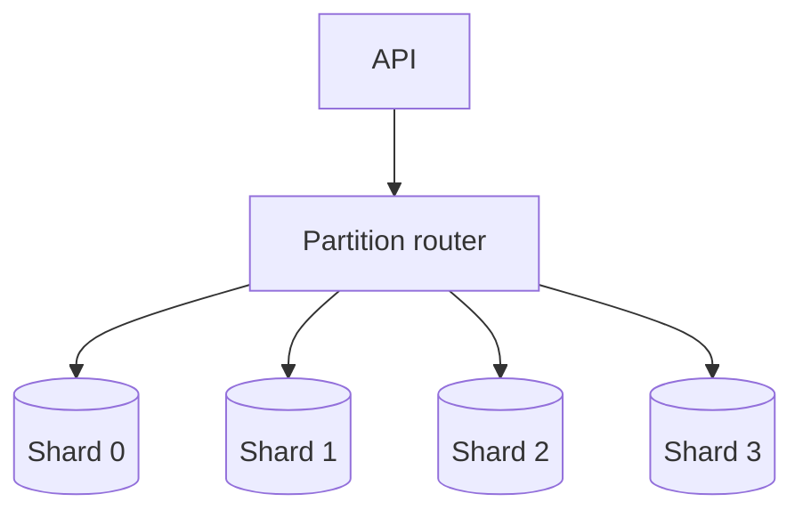
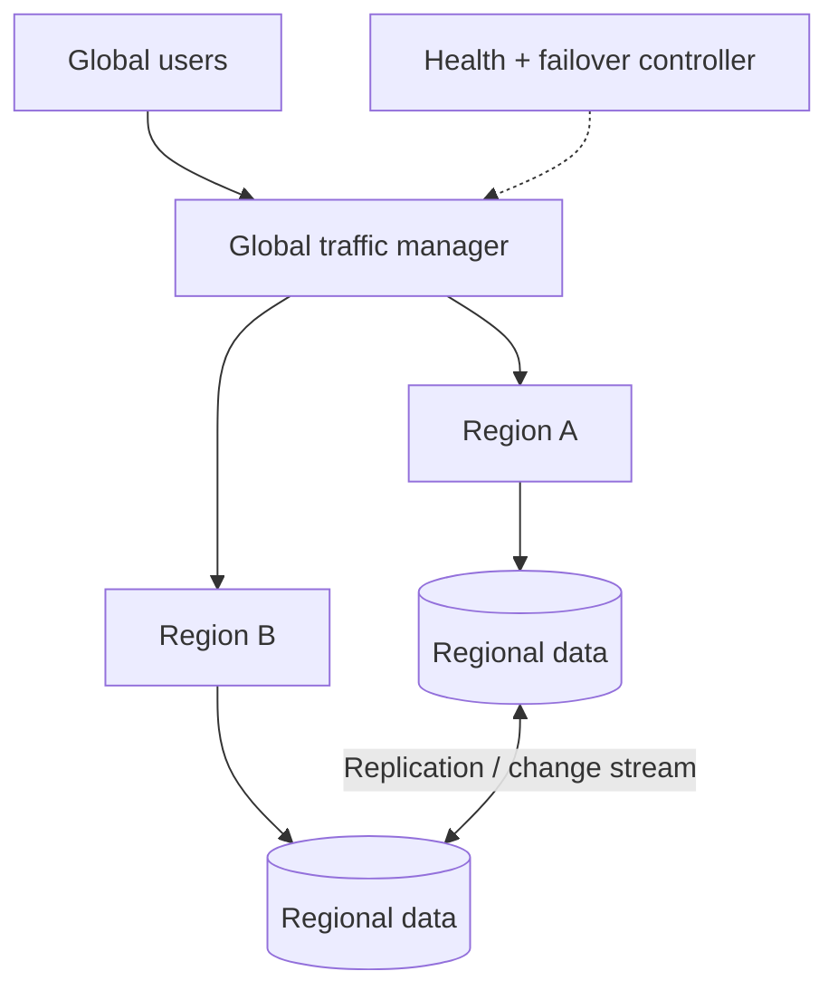

# Scale from Zero to Millions — Progressive System Design

This original case study evolves an application one bottleneck at a time. Each additional tier must solve a concrete workload or reliability constraint.

## Evolution map

## Stage 1 — One deployable unit

Good for a prototype or low traffic. Risks: shared resource contention, single host failure, local-disk coupling and difficult independent scaling.

## Stage 2 — Split application and data tiers

Scale and patch app and database independently. Secure the data tier behind private network controls. Watch connection pools, query plans and restore time.

## Stage 3 — Load-balanced stateless application

Move sessions and authoritative state out of application memory. Add health checks, readiness probes and graceful shutdown.

## Stage 4 — Cache and CDN

Serve static content at the edge. Add cache-aside for read-heavy data with an explicit freshness/invalidation model.

## Stage 5 — Database read scaling

Do not route read-after-write or strong reads to lagging replicas without session/version logic.

## Stage 6 — Async work and independent workers

Move email, media processing, webhook fanout and analytics out of the interactive path. Add idempotency, bounded retries, DLQs and backlog alarms.

## Stage 7 — Data partitioning

Choose partition keys based on query locality and cardinality. Plan hot-key mitigation, resharding and cross-shard workflows before rollout.

## Stage 8 — Multi-region resilience

Define region ownership, write conflict policy, replication lag tolerance, failover RTO/RPO and tested recovery. DNS failover alone does not solve data consistency.

## Stage 9 — Operations and service boundaries

Split services around ownership, independent scaling, failure isolation or team autonomy—not fashion. Add golden signals, business metrics, tracing, runbooks, automated deploy/rollback and capacity tests. Track cost per successful action.

## Interview exercise

Take a URL shortener, chat app or photo-processing service. For every stage name: the observed constraint, minimum change, new failure modes, metric proving improvement and added cost/complexity.

Use [Breakscale workload testing](../BREAKSCALE_TESTING.md) to explore simulated capacity, queueing, retries and injected failures. It is not a production load test.

## Attribution / further reading

- [ByteByteGo — Scale from Zero to Millions of Users](https://bytebytego.com/courses/system-design-interview/scale-from-zero-to-millions-of-users)

This is an independently authored exercise, not a reproduction of course illustrations or prose.
