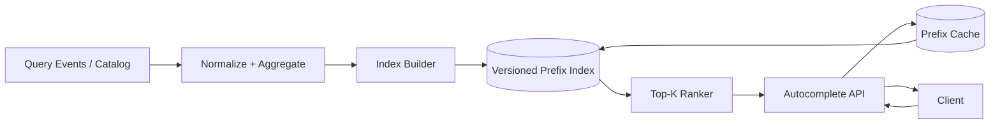
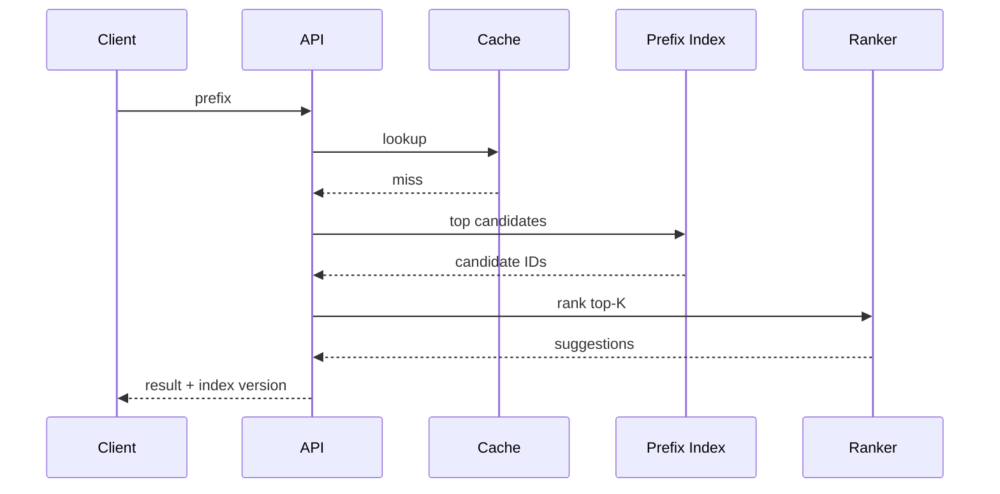

# Search Autocomplete

## Scope
Low-latency prefix suggestions, typo tolerance, popularity/personalized ranking, query normalization, caching, abuse controls and index refresh.

## Architecture

## Critical flow
Normalize query → check hot-prefix cache → prefix index lookup → retrieve top-K candidates → apply freshness/personalization/rules → return suggestions with index version. Build indexes offline/streaming and atomically swap versions.

## Data model
Suggestion(id, text, normalized, category, popularity, locale, policyStatus); PrefixIndex(version, prefix→candidate IDs); QueryEvent(hash, prefix, timestamp, locale); RankingFeatures; CacheEntry(prefix, topK, version, expiresAt).

## Failure modes
Index lag, hot prefixes, cache stampede, malformed Unicode, abusive scraping, stale personalization and index build failure. Use versioned atomic swap, request coalescing, quotas, normalization tests and fallback index.

## Trade-offs
Trie/FST vs search-engine prefix fields; top-K precompute vs online ranking; personalization vs privacy/latency; freshness vs rebuild cost.

## Interview walkthrough
Clarify languages/locales, latency budget, suggestion count, typo tolerance, personalization and data freshness. Estimate QPS and hot-prefix skew. Explain index build/swap, query path, cache, ranking and abuse controls.

## Visual explainer

## AI/FDE
Use AI for offline synonym/semantic expansion or query intent classification, not the latency-critical prefix path by default. Prompt defines structured candidates; Context uses safe query aggregates; Harness enforces privacy and budgets; Loop is bounded; Graph manages offline evaluation/index rollout. Validate suggestions against policy and canonical catalog.
