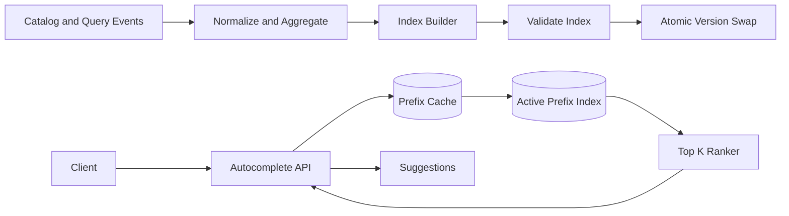
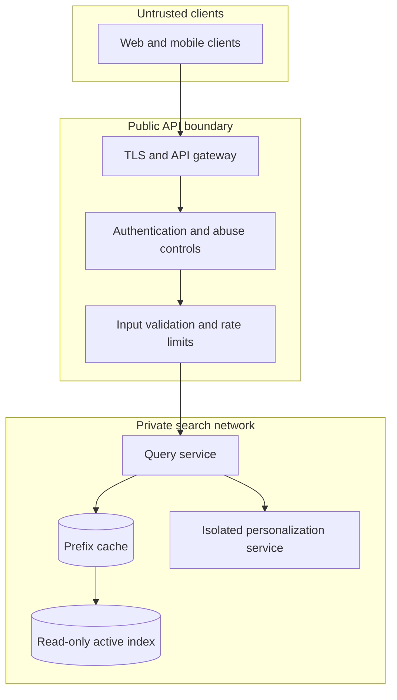

# Architecture — Search Autocomplete

Offline and streaming pipelines normalize query/catalog events, aggregate popularity and build a versioned prefix index. The builder validates a candidate index and atomically swaps the active version. The query service normalizes input, checks cache, reads a bounded candidate set, applies policy filters and ranks top-K. Personalization is an isolated optional path with a timeout fallback.

## Network and trust boundary

Treat query text as untrusted input. Enforce length and character limits, tenant/locale scope, rate limits and abuse detection at the API edge. Keep index administration and index publication off the public request path. Personalization features must be separately authorized and should have a non-personalized fallback.

## Scale progressively

1. **Small corpus:** one query service and an in-memory or managed prefix index; measure p95/p99 and candidate count.
2. **Separate build from serve:** build immutable index snapshots asynchronously; validate then atomically publish a version.
3. **Cache hot prefixes:** cache normalized prefix + locale + policy scope; coalesce concurrent misses.
4. **Partition the index:** shard by locale, tenant or leading prefix range; keep routing metadata and version consistency explicit.
5. **Bound ranking:** retrieve a small candidate set; apply deterministic filters first; call personalization only within a strict deadline and fall back on timeout.
6. **Operate safely:** monitor index age, build failures, cache hit ratio, empty-result rate, latency and abuse throttling.

Do not distribute the index or add online ML until corpus size, QPS or relevance measurements justify the complexity.

## Operations

Use sharded locale/index partitions, cache popular prefixes, coalesce misses and retain a fallback prior index. Monitor p99, cache hit ratio, index age, candidate count, policy-filter rate and build failures.
