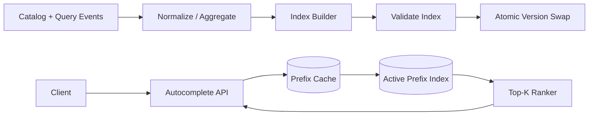

# Architecture — Search Autocomplete

Offline/streaming pipeline normalizes query/catalog events, aggregates popularity and builds a versioned prefix index. Builder validates index and atomically swaps active version. Query service normalizes input, checks cache, reads bounded candidate set, filters policy and ranks top-K. Personalization is an optional isolated feature path with timeout fallback.

Use sharded locale/index partitions, cache popular prefixes, coalesce misses and maintain a fallback prior index. Monitor p99, cache hit ratio, index age, candidate count, policy-filter rate and build failures.
