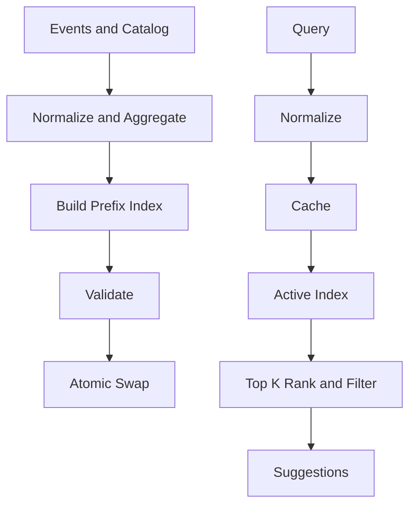
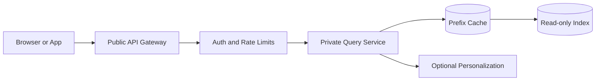
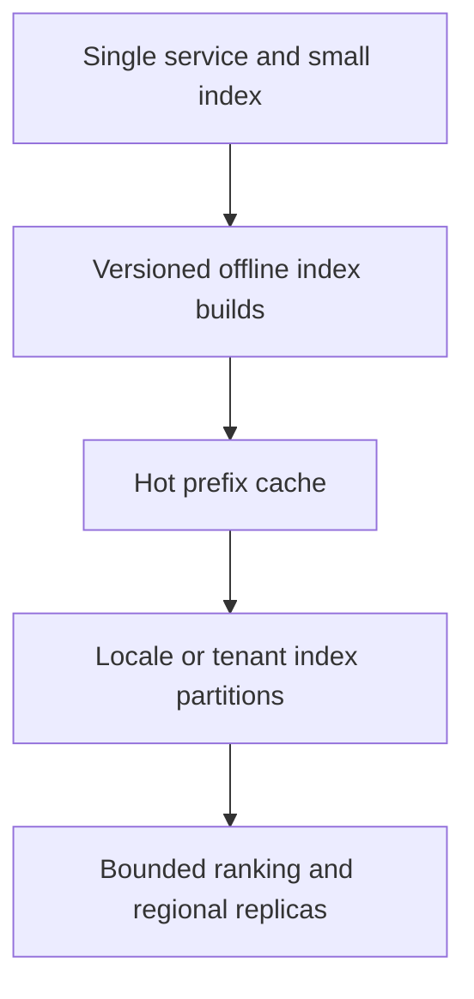

# Visual Explainer — Search Autocomplete

## Index build and query path

## Network and trust boundary

## Scale progressively

Index publication is a control-plane operation. User queries access only the active read-only index. Keep ranking bounded and preserve a deterministic fallback.
