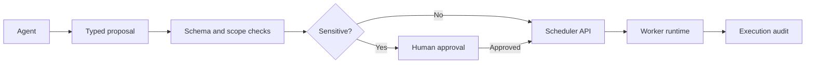

# AI / FDE Implementation

An agent may propose a job. Trusted scheduler code validates tenant, permissions, quotas, deadlines and approval before execution.

MCP is a protocol, not an authorization boundary. Evaluate task success, duplicate effects, retries, latency and cost.
