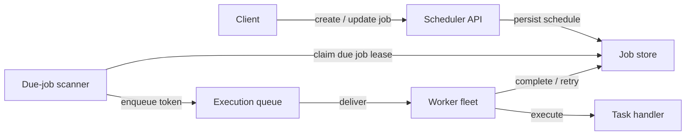
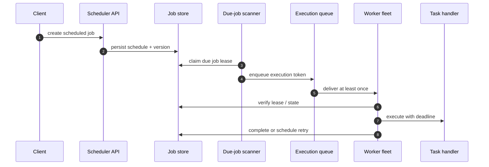
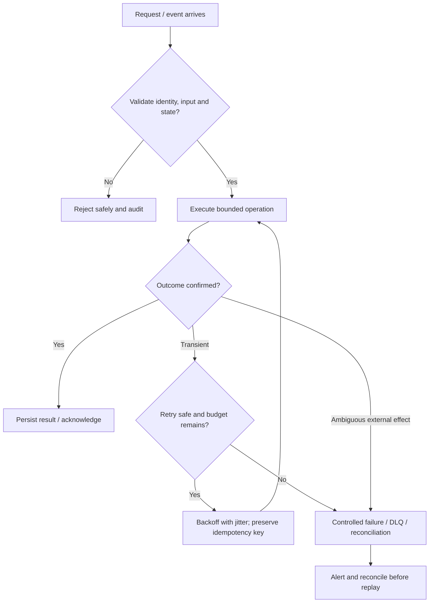

# Distributed Task Scheduler — Visual Architecture Explainer

> Conceptual HLD based on this repository's design notes. Confirm workload assumptions, service semantics and deployment choices before implementation.

## 1. System architecture

Follow the primary request path first. Storage, policy, queue and telemetry are supporting boundaries; they are not interchangeable.

## 2. Critical interaction

## 3. Failure and recovery

## 4. Core invariants

- Job state is durable and transitions are conditional/versioned.
- Execution is at-least-once unless a stronger end-to-end contract is proven.
- Lease fencing prevents stale workers from committing state.

## 5. Architecture decisions to defend

- Clarify one-time/recurring schedules, precision, misfire policy, cancellation, concurrency and execution guarantees.
- Design durable job state, due index/timer wheel, scanner leases, queue, workers and handler registry.
- Walk create → due claim with lease → enqueue token → worker lease validation → execute → complete/retry.

| Concern | AWS starting point | GCP starting point |
|---|---|---|
| Compute / API | API Gateway + ECS/Lambda as appropriate | API Gateway / Cloud Load Balancing + Cloud Run/GKE |
| Durable state | RDS/Aurora or DynamoDB based on access pattern | Cloud SQL/Spanner/Firestore based on access pattern |
| Async work | SQS/SNS/EventBridge/Kinesis as needed | Pub/Sub/Eventarc as needed |
| Operations | CloudWatch, X-Ray, IAM, Secrets Manager | Cloud Logging/Monitoring/Trace, Cloud IAM, Secret Manager |

These are starter mappings, not exact equivalents. Choose services from required consistency, ordering, retention, latency, regional scope and operational constraints.

## 6. Senior interview walkthrough (10 minutes)

### 0:00–1:00 — Frame the problem
Clarify one-time/recurring schedules, precision, misfire policy, cancellation, concurrency and execution guarantees.

### 1:00–2:00 — Requirements and invariants
Design durable job state, due index/timer wheel, scanner leases, queue, workers and handler registry.

### 2:00–4:00 — Draw and narrate the architecture
Walk create → due claim with lease → enqueue token → worker lease validation → execute → complete/retry.

### 4:00–6:00 — Walk the critical path
Explain recurrence calculation, time zones/DST, idempotency, lease fencing and duplicate dispatch.

### 6:00–8:00 — Failure, recovery and operations
Failure cases: scanner crash, worker crash after side effect, lease expiry, queue outage, misfire backlog and poison job.

### 8:00–9:00 — Trade-offs and alternatives
Trade-offs: polling vs timing wheel; precision vs cost; at-least-once dispatch vs dedupe.

### 9:00–10:00 — Close with measurable signals
Name the SLOs and operational signals that demonstrate correctness and capacity: user-visible latency/error rate, saturation, queue age/lag where applicable, retry/duplicate rate, and domain success metrics. State what would trigger a redesign rather than claiming unlimited scale.

## 7. Follow-up questions to rehearse

- How do you handle DST?
- How do you prevent duplicate execution?
- How do you recover from scanner outage?
- How do you support cancellation while running?

## Archify source

Editable Archify diagram IR: archify/task-scheduler.architecture.json. Generate the interactive HTML with the Archify skill/CLI from the repository root. The Mermaid diagrams above render directly on GitHub.
