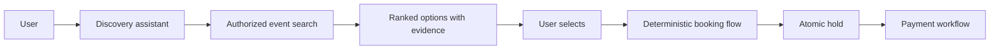

# AI / FDE Implementation

AI can assist event discovery, accessibility and support. It must not bypass inventory holds, queue fairness, payment or ticket ownership rules.

Keep tools read-only for discovery. Booking side effects require explicit user confirmation, idempotency and policy checks. Evaluate recommendation relevance and booking integrity.