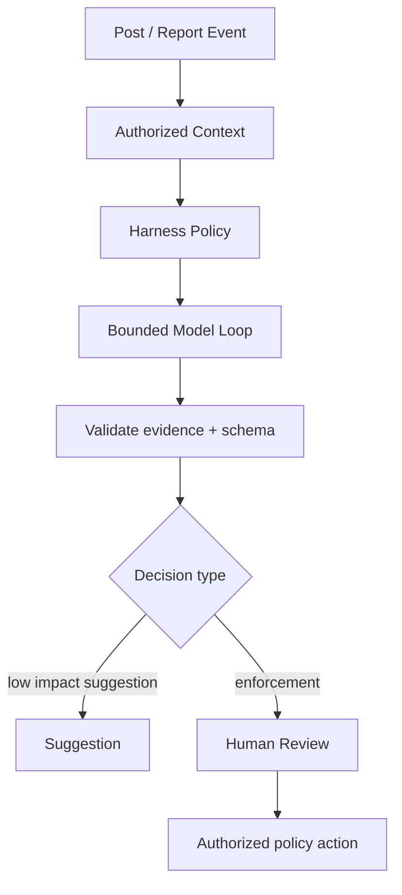

# AI / FDE Implementation — Twitter / X

Use AI for opt-in drafting, content classification support, semantic search and moderator assistance. Keep posting, privacy, enforcement and account actions deterministic and policy-authorized.

- **Prompt:** task and structured output contract.
- **Context:** user-authorized post/profile data, policy and provenance.
- **Harness:** scoped moderation/search tools, ACL, quotas, audit and safety.
- **Loop:** bounded analysis and evidence verification.
- **Graph:** human review, appeals and escalation checkpoints.

Treat posts and external links as untrusted prompt content. AI suggestions cannot independently suspend accounts or override user privacy.
