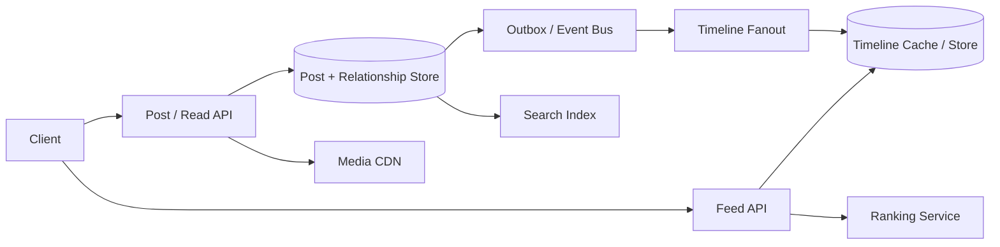
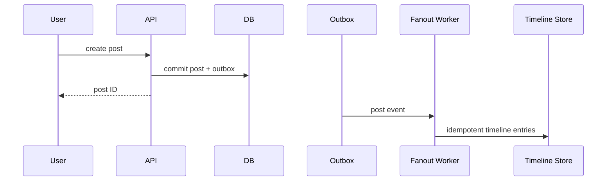

# Twitter / X-Style Social Platform

Design posts, follows, replies, likes, reposts, home timelines, search, trends and media with high-fanout accounts.

## Architecture

## Critical flow
Post creation commits canonical post + outbox. Fanout workers distribute post IDs to follower timelines. Feed reads merge cached candidates with fresh candidates, filter privacy/deletes, rank and hydrate. Large celebrity accounts use fanout-on-read or hybrid routing.

## Data model
User, Post(id, authorId, body, visibility, createdAt), Follow(followerId, followeeId), Interaction(userId, postId, type), TimelineEntry(userId, postId, score, insertedAt), Event(eventId, postId, type).

## Failure modes
Lost outbox event, duplicate fanout, hot celebrity, stale follow graph, privacy change lag, ranking timeout and abusive posting. Use outbox, idempotent consumers, hybrid fanout, privacy recheck, bounded ranking fallback and rate limits.

## Trade-offs
Fanout-on-write vs read; timeline freshness vs latency; pre-ranking vs online ranking; cache size vs recomputation; global trends accuracy vs windowed aggregation.

## Interview walkthrough
Clarify post volume, follower distribution, read/write ratio, timeline freshness and media scope. Estimate fanout deliveries/sec. Explain post durability, timeline materialization, celebrity handling, privacy filtering and ranking fallback.

## Visual explainer

## AI/FDE implementation
Use AI for optional post drafting, safety triage and semantic search. Prompt defines output; Context is ACL-filtered; Harness controls tools/policy; Loop is bounded; Graph coordinates appeals/review. Never let model output bypass privacy, moderation policy or user confirmation.
