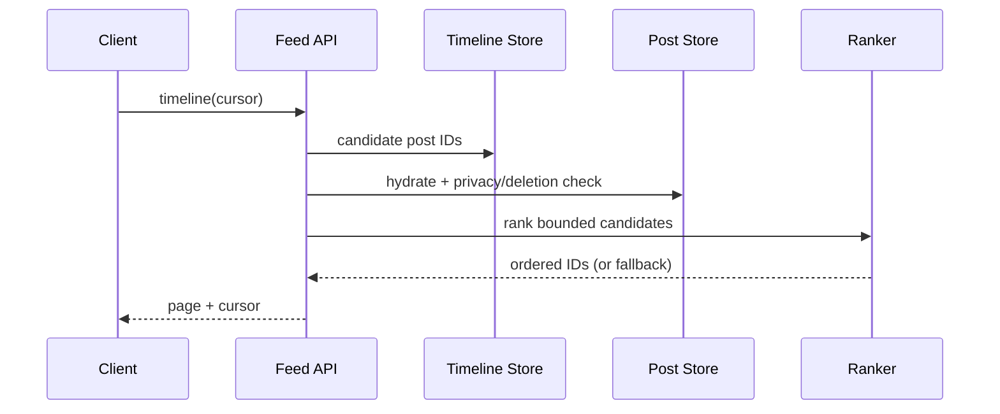

# Architecture — Twitter / X-Style Platform

## Components
Post service owns canonical posts; relationship service owns follow edges; outbox publishes committed mutations; fanout workers populate timeline projections; feed service fetches candidates and hydrates canonical visibility; ranking service is bounded with fallback; search/trends are derived pipelines.

## Feed sequence

## Scaling
Partition posts by postId/authorId; relationship edges by follower/followee access patterns; timeline by userId. Hybrid fanout avoids exploding writes for celebrity accounts. Use cursor pagination, cache hot profiles/posts and isolate ranking latency.

## Operations
Track post-write latency, fanout lag, feed p99, cache hit ratio, stale/deleted content leakage, ranking timeout and hot-key skew. Rebuild timeline projections from canonical posts and relationship snapshots.
