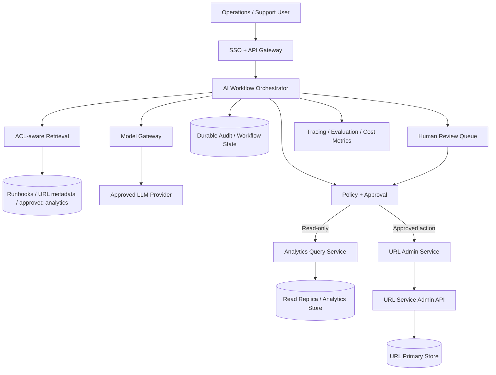
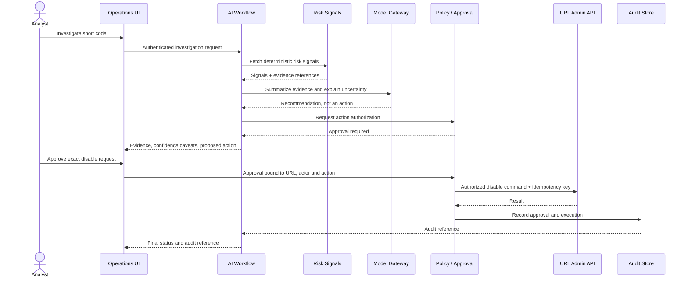
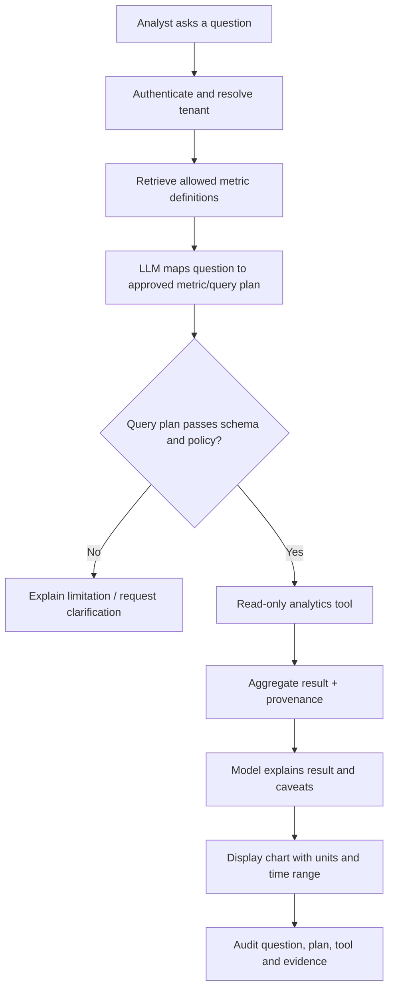

# URL Shortener — AI Architect / FDE Extension Guide

This is an optional extension to the repository's existing URL Shortener design. The core system remains a deterministic URL creation and redirect service. AI is not required for shortening or redirecting URLs. AI can add value around abuse operations, support, analytics exploration and operator workflows—but must stay outside the latency-critical redirect path.

## 1. Use cases and boundaries

| Use case | AI fit | Safer architecture |
|---|---|---|
| URL validation and redirect | Poor | Deterministic validation and key-value lookup |
| Abuse / phishing investigation assistance | Possible | Risk signals + classifier or LLM explanation; human decision |
| Natural-language analytics questions | Good | Semantic layer over approved aggregate metrics; read-only tools |
| Support assistant | Good | RAG over authorized documentation and audit events |
| Automatically disable suspicious URLs | High risk | Risk score proposes action; policy + human approval |
| Generate marketing descriptions for links | Good | Draft only; user reviews text |

Do not insert an LLM into `GET /:shortCode`. Keep the redirect path short, deterministic and cache-first.

## 2. Extension architecture

The analytics assistant reads aggregated and authorized data. The admin service remains the only component capable of changing URL state. The model itself has no direct database or unrestricted shell access.

## 3. Abuse-review sequence

## 4. Natural-language analytics flow

Never execute raw model-generated SQL. Use parameterized, read-only metric APIs with allowlisted dimensions and bounded date ranges.

## 5. FDE deployment plan

1. Shadow mode: classify and summarize only; no side effects.
2. Analyst pilot: show evidence and recommendations, require human decision.
3. Measure usefulness: review time, agreement rate, false positives, false negatives and escalation rate.
4. Controlled tool pilot: enable one narrow admin action behind explicit approvals and idempotency.
5. Production rollout: tenant-aware authorization, durable audit, runbooks, alerting, rollback and clear ownership.

## 6. Evaluation set

Include:
- Known benign links and known abuse examples with verified evidence
- Ambiguous or conflicting signals
- Missing metadata and stale analytics
- Cross-tenant access attempts
- Prompt injection in user-controlled URL metadata or page content
- Tool schema violations and permission denial
- Model/provider timeout and analytics API outage
- Duplicate approval or retried disable request

Track precision/recall for risk classification, analyst acceptance, action reversal rate, time-to-investigation, evidence completeness, p95 latency and cost per completed investigation. Establish thresholds with the actual operations team; do not invent universal thresholds.

## 7. Prompt for an agentic implementation slice

> Implement the read-only natural-language URL analytics assistant described in this document. Inspect the existing URL Shortener service, data model and repository conventions first. Do not modify the redirect path or introduce an LLM dependency into `GET /:shortCode`.
>
> Start by proposing: authorized metric catalog, API contract, tenant scope propagation, query limits, result provenance, prompt-injection boundaries, tests and rollout plan. Do not write code until the design is internally consistent.
>
> Implement one vertical slice: authenticated question → approved metric plan → schema-validated read-only analytics tool → result with provenance → concise explanation. Do not permit arbitrary SQL, shell, database writes or unrestricted URL fetching.
>
> Add tests for allowed query, invalid dimension, oversized date range, tenant isolation, prompt injection, tool timeout and provider failure. The model cannot grant permissions. The trusted server must enforce authorization.
>
> Run all relevant tests, type-check and lint. Report exact commands/results, limitations and rollback instructions. Update diagrams only when the implementation changes the design.

## 8. Interview message

“The core shortener remains deterministic and optimized for redirects. I add AI only to support workflows where language and evidence synthesis matter, such as abuse investigation and analytics exploration. The assistant has read-only capabilities by default. Any state-changing action goes through an authenticated admin API, policy check, human approval and an idempotency key. I would pilot this in shadow mode, measure analyst outcomes and only expand permissions when the evaluation supports it.”
