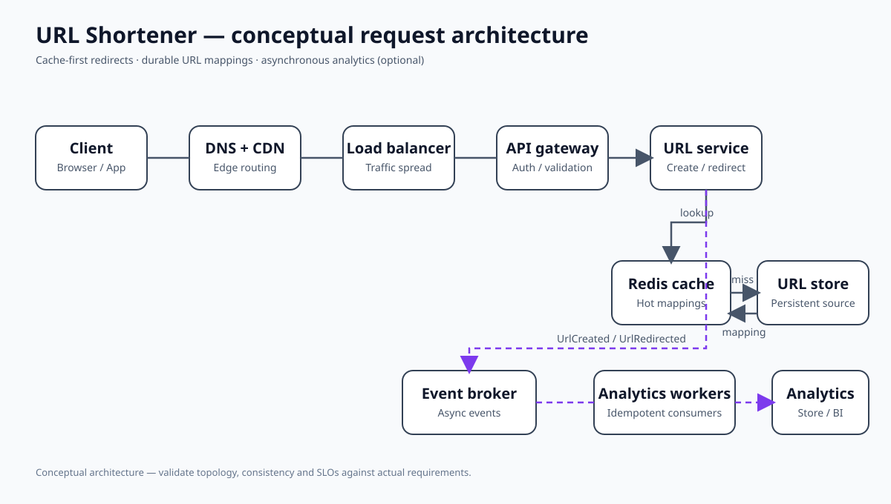

# URL Shortener — High-Level Design

## Problem

Shorten long URLs and redirect users reliably. The original requirements define a read-heavy system with a stated target of less than 50 ms for cache-hit redirects and 99.99% availability.

## Requirements and baseline workload

- Create a short URL from a long URL.
- Redirect a short code to its original URL.
- Optional custom aliases and expiry.
- Supplied workload assumption: 1M new URLs/day and 100M redirects/day (roughly 100:1 reads to writes).
- Supplied storage assumption: approximately 160 bytes per mapping, or about 58 GB/year before indexes, replicas and backups.

See [requirements and assumptions](requirements.md).

## Architecture

The system is stateless at the application tier and cache-first for redirects. Redis is an optimization; the persistent mapping store is the source of truth. See the [full architecture diagrams](architecture.md).

## Critical flows

- [Redirect sequence and cache miss path](architecture.md#3-redirect-sequence)
- [URL creation and persistence](architecture.md#4-url-creation-sequence)
- [Cache failure and recovery decision](architecture.md#5-cache-aside-flow-and-failure-handling)
- [Asynchronous analytics](architecture.md#7-analytics-event-flow)

## Data model

The minimum entity is a short-code mapping to a long URL, with creation and optional expiry metadata. Analytics events are a separate optional capability. The data model diagram is in [architecture.md](architecture.md#6-data-model).

## Scaling and trade-offs

- Keep the redirect path deterministic and cache-first.
- Add CDN caching for globally popular redirects where redirect status and expiry semantics permit it.
- Add sharding only after storage, write throughput or index limits justify it.
- Keep analytics asynchronous and idempotent.
- Evaluate primary/replica routing against the product's read-after-write and revocation requirements.
- Prefer a clear active-passive multi-region plan unless active-active is required by an explicit RTO/RPO or geography target.

## AI / Agentic extensions

AI does not belong in the redirect path. Use it selectively for read-only natural-language analytics, support assistance or abuse investigation. Any state-changing action must go through an authorized admin API and explicit policy/approval workflow.

See the [AI Architect / FDE implementation guide](AI_FDE_IMPLEMENTATION.md).

## Interview walkthrough (10 minutes)

1. Clarify create, redirect, alias, expiration and analytics scope.
2. Estimate read/write QPS and storage; explain the read-heavy workload.
3. Draw the cache-first read path and durable write path.
4. Explain code generation and uniqueness/collision handling.
5. Walk through cache miss, DB outage, hot key and replication lag.
6. Discuss sharding, CDN, queueing and multi-region only when needed.
7. Close with latency, availability, cost and operational trade-offs.

## Implementation prompt

Use the repository's [AI/Agentic implementation guidelines](../../docs/AI_AGENTIC_IMPLEMENTATION_GUIDELINES.md) and the [AI/FDE prompt](AI_FDE_IMPLEMENTATION.md#7-prompt-for-an-agentic-implementation-slice).