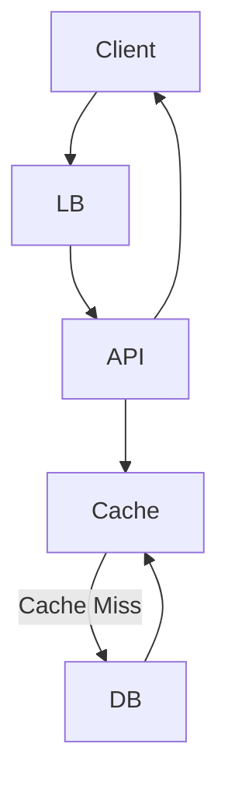
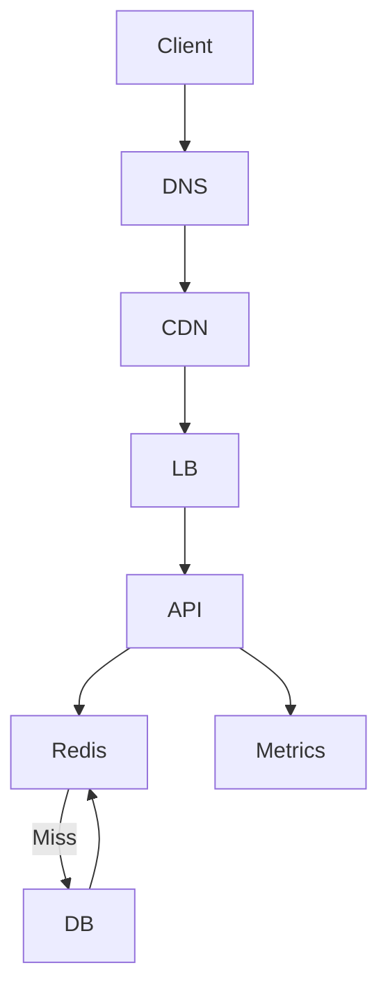

# High Level Architecture

The system is composed of stateless services backed by a cache and a persistent database.

## Core Components

- Client (Browser / Mobile App)
- Load Balancer
- API Gateway
- URL Service
- Cache (Redis)
- Database (NoSQL)

## Architecture Diagram

# Core Components

## Load Balancer
- Distributes traffic across API servers
- Improves availability and scalability

## API Gateway
- Handles authentication, validation, and routing
- Shields backend services

## URL Service
- Generates short codes
- Handles redirects
- Stateless to allow horizontal scaling

## Cache (Redis)
- Stores hot URL mappings
- Reduces database load
- Improves latency

## Database
- Persistent storage for URL mappings
- Optimized for key-value access

# Extended Architecture (ByteByteGo Level)

This document expands the core architecture to handle:
- Global scale
- Fault tolerance
- Observability
- Security
- Operational concerns

---

## Global Architecture Overview

## Why Add These Layers?

### DNS

- Routes users to nearest region
- Enables geo-based traffic steering

### CDN

- Caches redirects for ultra-hot URLs
- Reduces latency for global users

### Metrics & Monitoring

- Detects failures before users do
- Enables auto-scaling and alerting

---

## Regional Deployment

- Multi-region active-active setup

Each region has:

- API servers

- Redis cluster

- DB replicas

Writes may be routed to a primary region depending on consistency needs.

---