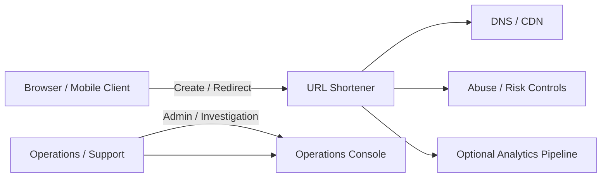
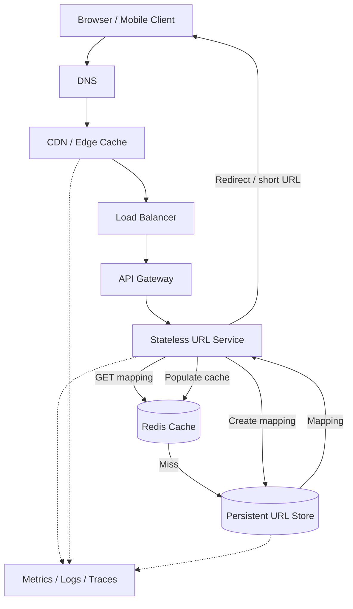
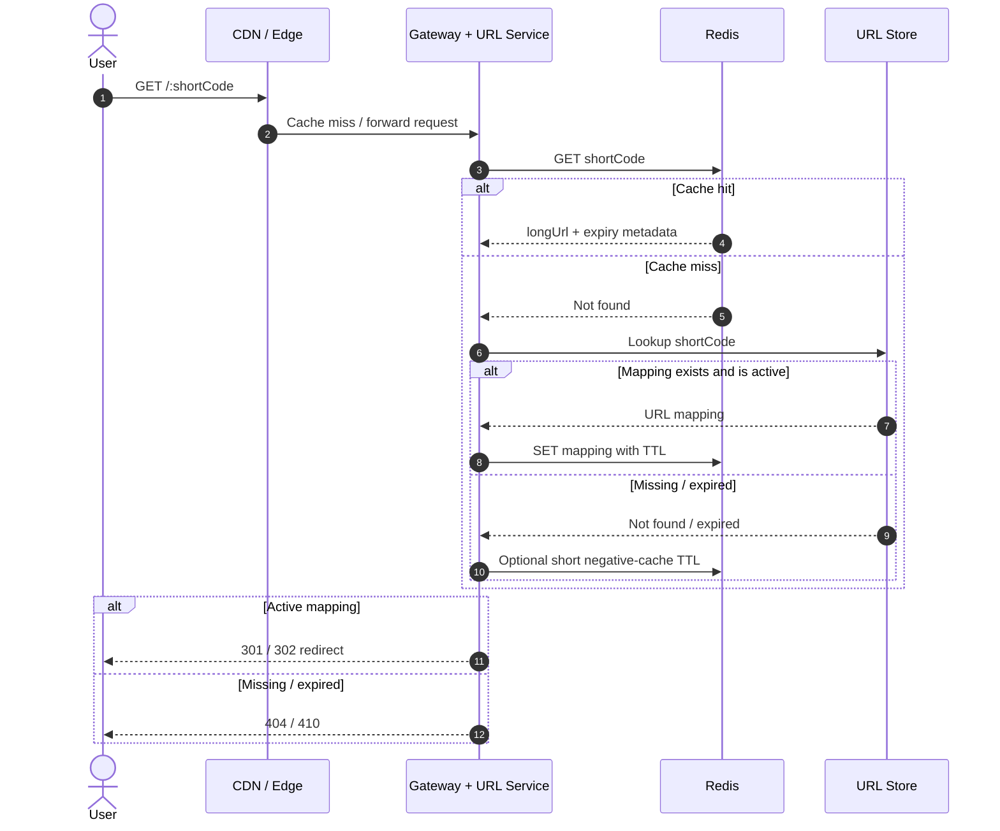
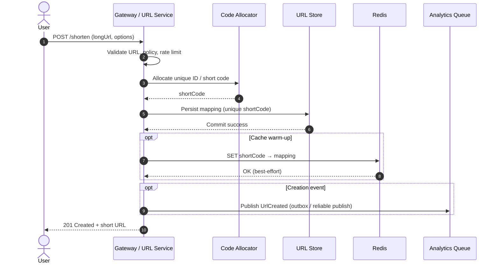
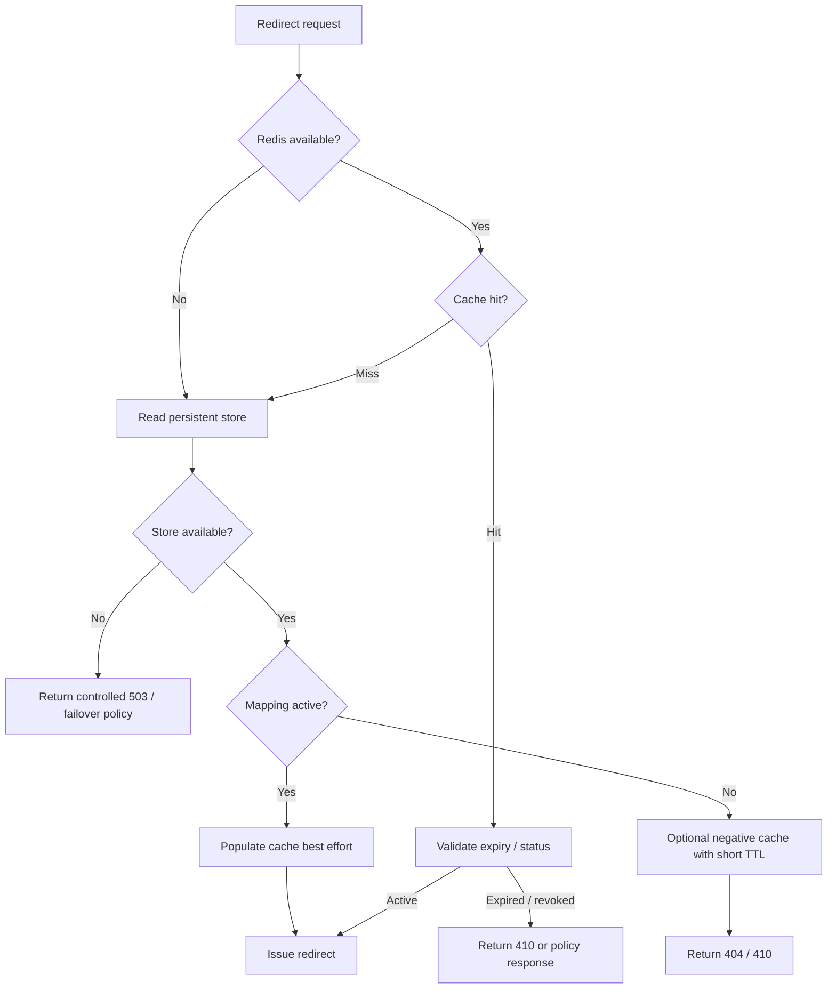
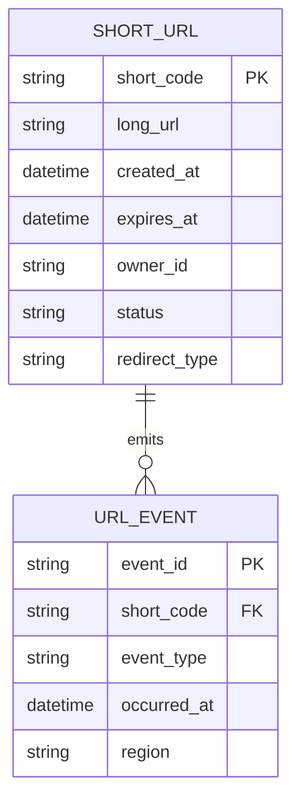
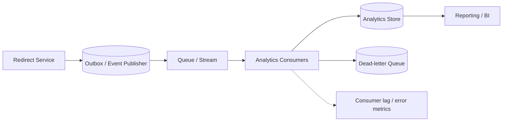
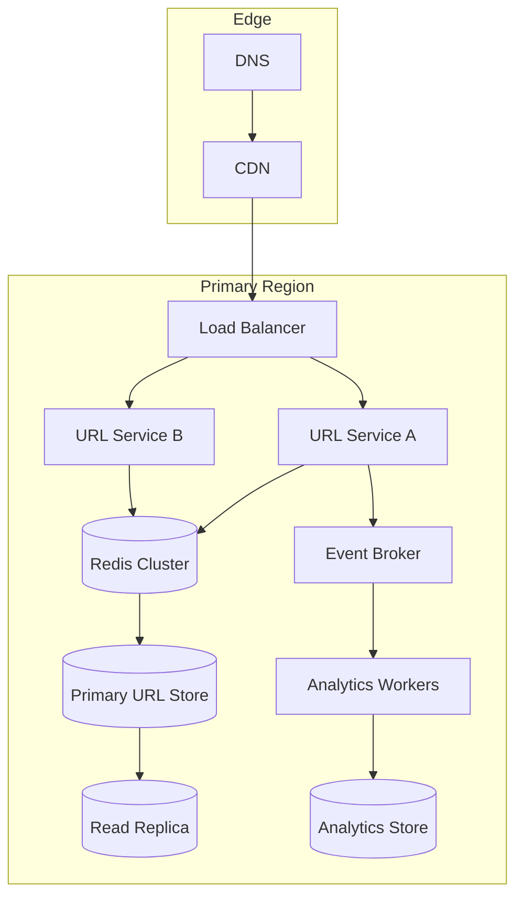
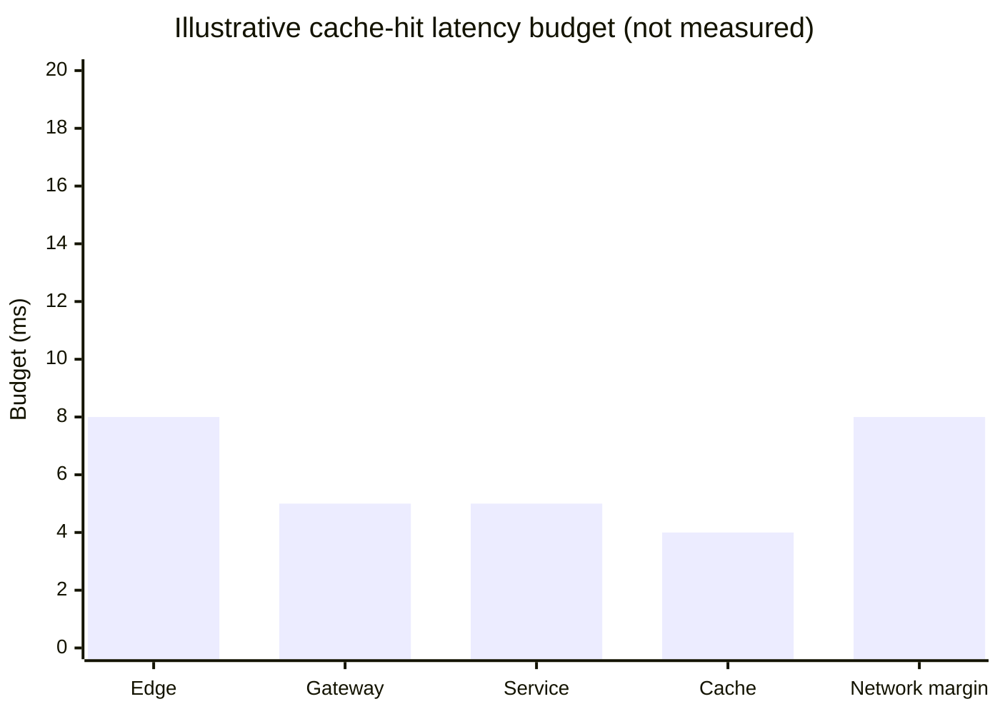
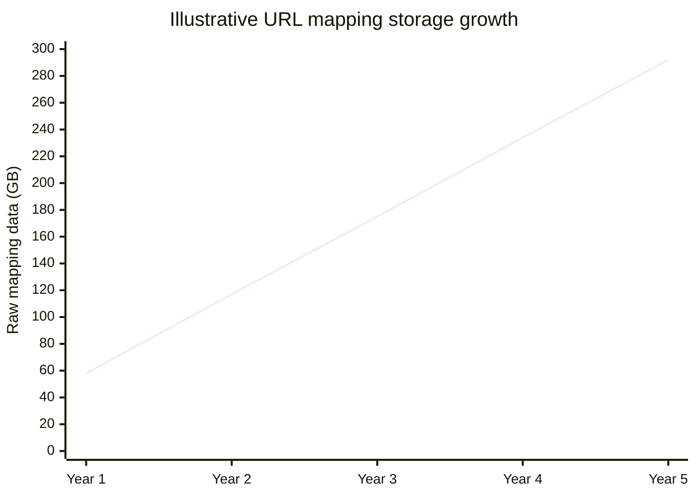

# URL Shortener — High-Level Architecture

The current design targets a read-heavy workload: the supplied estimate is approximately 1,200 redirect reads/s and 12 creates/s. The baseline is stateless application services, a cache-first redirect path, and durable URL mapping storage.

## 1. System context

The core shortener owns URL creation and redirects. CDN, abuse controls and analytics are supporting capabilities, not part of the minimum redirect path.

## 2. Core container architecture

**Read path:** cache first, persistent store on miss.  
**Write path:** validate and allocate a unique code, persist the mapping, then optionally warm the cache. A write is successful only after durable persistence succeeds.

## 3. Redirect sequence

The choice between permanent and temporary redirects affects browser and CDN caching behavior. It must be a product decision; the existing requirements do not settle it.

## 4. URL creation sequence

For reliable event publication, use a transactional outbox or another explicit durability strategy. A direct database commit followed by best-effort publish can lose events if the process crashes between steps.

## 5. Cache-aside flow and failure handling

Do not claim that the system can always “fail open” during a database outage: without a cached mapping, the service cannot resolve the destination. Behavior depends on cache availability and freshness.

## 6. Data model

The event table is an optional analytics representation. At high volume, click events may belong in an append-oriented analytics store rather than the operational URL mapping database.

## 7. Analytics event flow

At-least-once delivery implies duplicate events are possible. Give events stable IDs and make consumers idempotent. Analytics failure must not block the redirect response.

## 8. Deployment view (conceptual)

This is a logical deployment sketch, not a prescribed AWS/GCP topology. Multi-region active-active requires separate write-ownership and conflict-resolution design; the existing notes prefer active-passive unless requirements justify the added complexity.

## 9. Latency and capacity visuals

The original requirements state a cache-hit redirect target under 50 ms. The following is an **illustrative budget**, not a benchmark or claim about actual service latency.

An illustrative 30 ms subtotal leaves 20 ms of margin against the stated 50 ms target. Validate the real budget with regional p50/p95/p99 traces.

From the existing requirements assumptions:
- 1,000,000 creates/day ≈ 11.6 writes/s (rounded to ~12)
- 100,000,000 redirects/day ≈ 1,157 reads/s (rounded to ~1,200)
- 160 bytes/record × 1M new records/day × 365 days ≈ 58.4 GB/year before indexes, replication, backups and overhead

This assumes 1M newly created URLs each day, 160 bytes per record and no deletion/expiry reduction. It excludes indexes, replicas, backups and analytics. It is a planning estimate, not observed capacity.

## 10. Operational signals

- Redirect request rate and status code distribution
- p50 / p95 / p99 redirect latency by region and cache outcome
- Cache hit ratio, evictions, connection errors and stampede indicators
- Primary database read/write latency, throttling, replication lag and failover state
- Short-code allocation collision/retry count
- Queue publish failures, consumer lag, retry count and DLQ depth
- Abuse/rate-limit decisions and administrative changes
- Cost per million redirects and storage per active URL

## 11. Design decisions to defend

| Decision | Current baseline | Revisit when |
|---|---|---|
| Cache strategy | Cache-aside | Cache invalidation or stampede becomes dominant |
| Code strategy | Monotonic ID + Base62 in supplied master prompt | ID service contention, allocation gaps or multi-region ownership matter |
| Consistency | Eventual consistency acceptable for reads | Product requires immediate revocation or global read-after-write |
| Sharding | Add only after single-store limits | Sustained write/storage/index bottleneck |
| Queue | Analytics and non-critical work only | Background events need replay or independent scaling |
| Multi-region | Prefer active-passive absent a strong need | RTO/RPO or geography requirements justify active-active |

See [requirements](requirements.md), [failure modes](failure_modes.md), [consistency and replication](consistency_and_replication.md), [patterns applied](patterns_applied.md), and the [AI / FDE extension](AI_FDE_IMPLEMENTATION.md).
