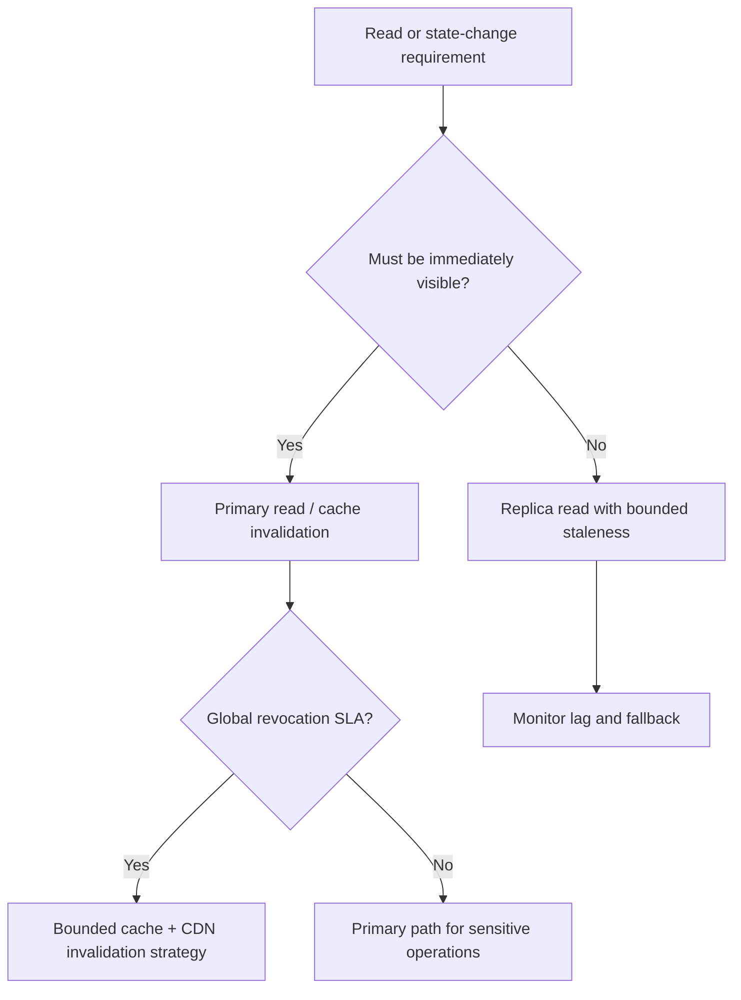

# Consistency and Replication

## Baseline consistency model

The existing design accepts eventual consistency for some read paths. The trade-off must be tied to product behavior:

- Newly created URL may not appear immediately on a lagging read replica.
- Negative cache can temporarily hide a just-created mapping.
- A revoked or expired URL may remain visible in a stale cache if invalidation/TTL is not handled.

The original notes identify URL creation as relatively rare and slight redirect delay as acceptable. Treat this as an assumption to validate, not a universal property of URL shorteners.

## Read-after-write options

1. Route the creator's first redirect to the primary.
2. Use session/region affinity for recently created mappings.
3. Warm cache after durable create.
4. Use short negative-cache TTL or invalidate negative entries on create.

## Revocation and expiry

A stronger revocation SLA may require:
- explicit cache invalidation on state change
- short maximum cache TTL
- versioned mapping metadata
- CDN purge or bounded edge TTL
- origin check for high-risk URLs

The chosen approach trades latency and origin load against revocation freshness.

## Replication

A primary with asynchronous read replicas is a possible baseline:
- writes commit to primary
- reads may use replicas where lag is acceptable
- monitor replication lag
- use primary reads for consistency-sensitive operations

## Consistency decision flow

## Interview questions

- Can a just-created URL return 404 on first redirect?
- How does expiration interact with CDN caching?
- What is the maximum stale-read window?
- What happens if cache invalidation fails?
- When should a request bypass a replica?