# Failure Modes and Mitigations

| Failure | User/system impact | Mitigation / design question |
|---|---|---|
| Redis unavailable | Cache-hit path disappears; origin load and latency rise | DB fallback, circuit breaker, connection limits and load shedding |
| Cache stampede | Many misses hit DB at once | TTL jitter, request coalescing, per-key lock, warm popular keys |
| Database unavailable | Cache hits may still redirect; cache misses cannot resolve | Multi-AZ failover, bounded stale-cache policy, controlled 503 |
| Hot key | One short code overloads edge/cache/origin | CDN, replication/read scaling, request coalescing and rate controls |
| Replica lag | Newly created URL may appear missing | Primary read for read-after-write, bounded lag and negative-cache TTL |
| Code collision | Create operation fails or overwrites if uniqueness is weak | Unique constraint, retry allocation, collision telemetry |
| Analytics broker outage | Click metrics delayed or lost depending on publish design | Outbox, bounded queue, retries, DLQ; never block redirect |
| Poison event | Consumer repeatedly fails | Retry budget, quarantine/DLQ and replay tooling |
| Region outage | Redirect availability reduced | Explicit RTO/RPO, DNS/traffic failover, tested recovery |
| Abuse / phishing | Harmful destination distribution | Rate limits, reputation signals, reporting workflow and controlled disable |

## Cache/database fallback flow

```mermaid
flowchart TD
    A[Request] --> B{Cache usable?}
    B -->|Hit| C[Validate mapping freshness]
    B -->|Miss / unavailable| D[Read origin store]
    D --> E{Origin response?}
    E -->|Active mapping| F[Best-effort cache populate]
    E -->|Not found / expired| G[404 / 410 + short negative TTL]
    E -->|Unavailable| H[Controlled 503 / bounded stale policy]
    C -->|Fresh| I[Redirect]
    C -->|Expired / revoked| J[410 / policy response]
    F --> I
```

## Resilience principles

- A cache is not the source of truth.
- Do not overload the database during cache incidents; apply bulkheads and load shedding.
- Retries require bounded attempts, backoff and jitter.
- Side effects must be idempotent.
- DLQ messages require inspection, retention and safe replay.
- Runbooks must state user impact, mitigation, owner and rollback steps.