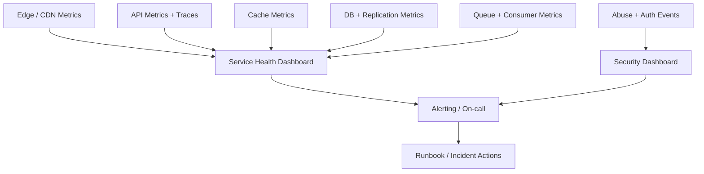

# Observability and Monitoring

Observability should let an operator answer: what failed, where, for whom, since when, and what is the current user impact?

## Metrics

| Area | Metrics |
|---|---|
| Traffic | Redirect/create QPS, per-region traffic, status code distribution |
| Latency | p50/p95/p99 redirect and create latency; cache-hit vs cache-miss |
| Cache | Hit ratio, eviction rate, connection pool saturation, timeouts |
| Database | Read/write latency, throttling, pool saturation, replication lag |
| Allocation | Collision retries, code allocator errors, duplicate alias attempts |
| Queue | Publish errors, backlog, consumer lag, retries, DLQ depth |
| Security | Rate-limit decisions, abuse reports, disable events, auth denials |
| Cost | Cache and DB cost per million requests, storage per active mapping |

## Logs and traces

- Structured logs should carry request ID, short code hash or safe identifier, region, cache outcome and response class.
- Avoid logging full long URLs when they may contain personal data, tokens or private query parameters.
- Trace the redirect request across edge, gateway, service, cache and database.
- Link asynchronous analytics processing with stable event IDs and trace context.

## Alerts

- High p95/p99 redirect latency
- Elevated 5xx / redirect error rate
- Sudden cache hit-ratio drop
- Redis connection failures or memory pressure
- Database throttling or replica lag
- Queue lag growth or sustained DLQ additions
- Unusual create rate, alias collision rate or abuse reports

## Dashboard layout

## SLO and error budget

The requirements state 99.99% availability, but do not define the measurement window or which endpoints count. Define:
- SLI: successful eligible redirects / total eligible redirect requests
- SLO window and exclusions
- latency objective at p95/p99
- error-budget burn alerts
- dependency-specific objectives and ownership

Do not equate a successful process health check with a successful redirect experience.