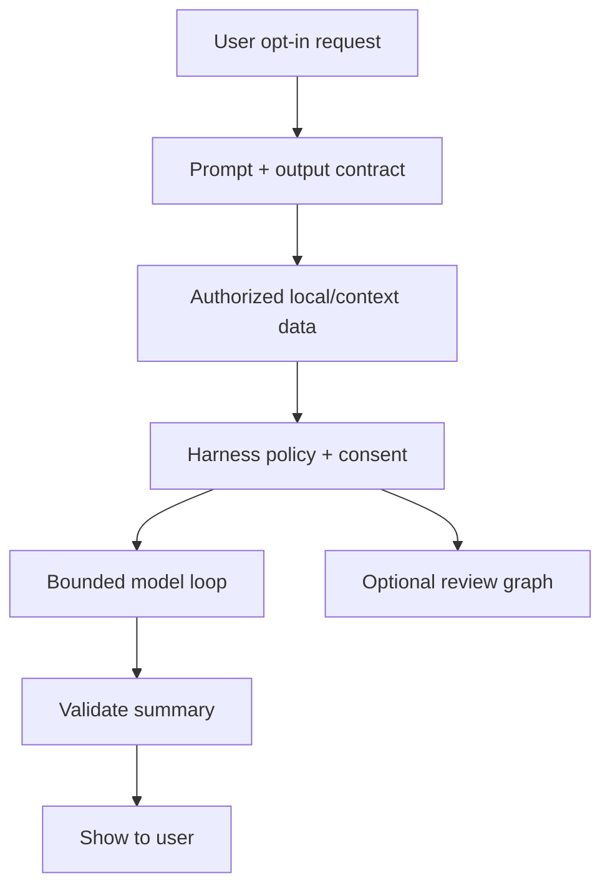

# AI / FDE Implementation — WhatsApp-Style Messaging

## Appropriate use cases
Opt-in client-side conversation summaries, user-requested translation, spam triage from reported content and support-agent assistance. Do not silently expose E2E plaintext to server-side inference.

## Five-layer mapping
- **Prompt:** task-specific output schema and safety constraints.
- **Context:** only user-authorized messages, locally decrypted where applicable, with provenance and bounded retention.
- **Harness:** capability allowlist, privacy checks, consent, scoped tools, audit and cost budgets.
- **Loop:** bounded summarize/verify cycle; no autonomous message sending.
- **Graph:** optional user approval, report review and support workflow checkpoints.

Treat message text as untrusted prompt-injection content. Model output must not alter membership, privacy settings or send messages without explicit user action.
