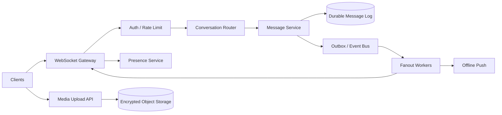
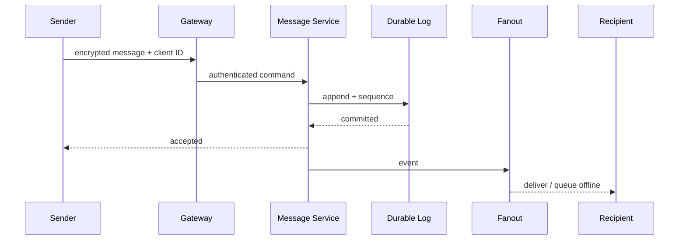

# WhatsApp-Style Messaging Platform

Design private and group messaging with durable delivery, per-conversation ordering, presence, receipts, multi-device sync, media and end-to-end encryption boundaries.

## Architecture

## Critical flows
Send: authenticate device → validate membership → dedupe clientMessageId → assign conversation sequence → durably append → acknowledge → fan out to online devices or enqueue offline push. Reconnect: client supplies last sync cursor; server returns missed messages/receipts and device-state updates.

## Data model
User, Device, Conversation, Membership, Message(conversationId, sequence, senderDevice, ciphertext, clientMessageId), Receipt, PresenceLease, Attachment. Partition message log by conversationId; use sequence numbers per conversation, not a global order.

## Failure modes
Duplicate sends, reconnect gaps, offline queue growth, hot groups, stale presence, device key changes and push-provider failures. Use idempotency, durable cursors, bounded offline retention, backpressure and push as a wake-up hint—not the source of truth.

## Trade-offs
Fanout-on-write vs read for large groups; durable receipts vs write amplification; presence freshness vs battery/traffic; server-side search vs E2E privacy constraints.

## Interview walkthrough
Clarify group size, device count, ordering guarantee, offline retention and encryption assumptions. Estimate messages/sec and fanout. Deep dive durable acceptance, sequence allocation, reconnect sync, group fanout, hot conversations and key management.

## Visual explainer

## AI/FDE implementation
Use AI only for optional user-controlled features such as local summaries or support triage. Prompt defines the task; Context is strictly user-authorized; Harness enforces privacy and tool scope; Loop is bounded; Graph supports opt-in review workflows. Do not send E2E plaintext to server-side models without explicit product design and consent.
