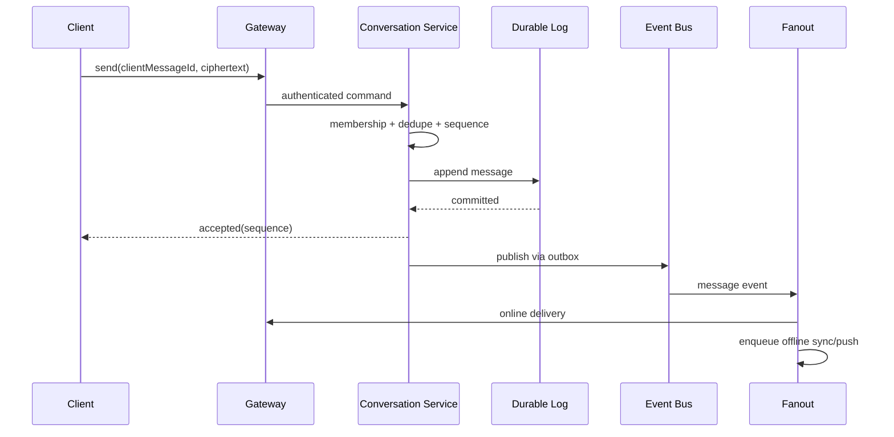

# Architecture — WhatsApp-Style Messaging

## Components
WebSocket gateways hold transient connections; conversation service owns membership and sequence allocation; durable message log stores ciphertext and metadata; fanout workers deliver to devices; sync service replays by cursor; presence service maintains expiring leases; push adapter wakes offline clients.

## Send sequence

## Scaling
Shard by conversationId; allocate sequence within the partition/aggregate. Large groups use fanout-on-read or hybrid strategy. Gateways are horizontally scaled with connection-aware routing; offline state is durable and independent of gateway memory.

## Security / operations
Authenticate devices, validate membership at send and sync, minimize server-visible content under E2E design, protect metadata, rate-limit abuse and audit account/device changes. Monitor accepted-message latency, fanout lag, reconnect backlog, socket churn, push errors and hot partitions.
