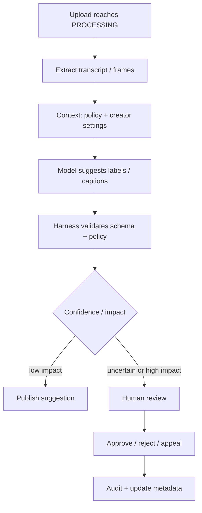

# AI / FDE Implementation — YouTube-Style Video Platform

## Safe AI use cases
Creator metadata assistance, caption draft/translation, moderation triage, semantic search and support-agent summaries. Keep upload finalization, visibility, copyright actions and payment/entitlement deterministic and policy-gated.

## Five-layer mapping
| Layer | Video platform responsibility |
|---|---|
| Prompt | Task-specific schema: caption segments, metadata suggestions or moderation evidence |
| Context | Authorized video metadata, transcript segments, creator locale and policy references |
| Harness | Model/provider adapters, scoped tools, ACL checks, safety policy, budgets, audit |
| Loop | Bounded analyze → tool/read → verify; stop on confidence/step/deadline budget |
| Graph | Durable review, appeal, translation and reprocessing branches with human approval |

## Example workflow

## Implementation sequence
1. Start with deterministic media-processing events and canonical state.
2. Add a read-only model task with structured output.
3. Add provenance for transcript/frame evidence and policy version.
4. Add human review before consequential moderation actions.
5. Evaluate quality, bias, false positives, latency and cost per processed minute.

## Guardrails
Treat transcripts, comments and uploaded metadata as untrusted. Model output never grants access or performs takedowns directly. Log model/prompt versions, evidence references and reviewer decisions; redact sensitive content from operational logs.
