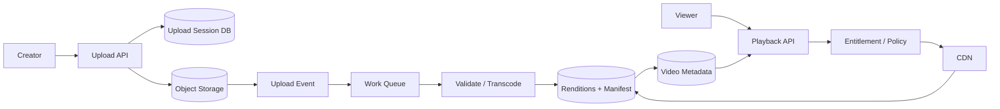
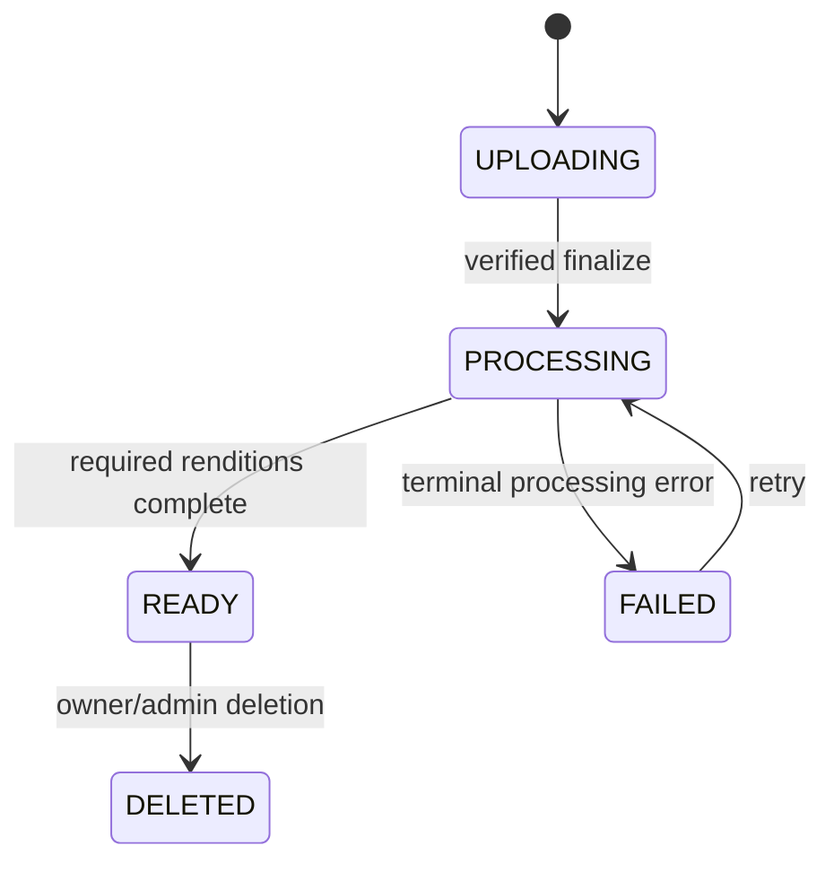

# YouTube-Style Video Platform

Design a global video platform for creators to upload, process, publish and stream video with adaptive playback, search, recommendations and engagement.

## Core decisions
- Separate control plane (metadata, upload sessions, entitlement) from media data plane (object storage, CDN).
- Publish only after required renditions and manifest are ready.
- Treat view counts and recommendations as derived, eventually consistent data.
- Use resumable multipart uploads and content-addressed processing where safe.

## Architecture

## Critical flows
Upload: create session → upload parts → verify checksum → finalize idempotently → enqueue processing → validate/transcode/package → publish READY. Playback: resolve video/manifest → check visibility/entitlement → issue short-lived playback token → CDN serves adaptive segments.

## Data model
Video(id, ownerId, title, visibility, state, createdAt); UploadSession(id, videoId, parts, checksum, expiresAt); Rendition(videoId, codec, resolution, bitrate, objectKey, status); PlaybackSession(id, viewerId, videoId, progress, tokenExpiry).

## Failure modes
Duplicate finalize, missing parts, poison transcode job, partial rendition set, expired token, CDN miss storm, origin outage and deletion propagation. Use idempotency keys, worker leases, retry/DLQ, readiness checks, signed URL refresh and origin shielding.

## Trade-offs
Rendition ladder vs storage/encode cost; CDN cache duration vs privacy/deletion; synchronous vs async processing; precomputed recommendations vs online ranking.

## Interview walkthrough
Clarify upload size, playback geography, concurrency, latency and availability. Estimate ingest bytes/day and peak segment QPS with assumptions. Explain upload and playback APIs, state machine, CDN strategy, processing retries, privacy and creator analytics.

## Visual explainer

## AI/FDE implementation
Use AI for title/description suggestions, captions, moderation triage and semantic discovery—not for deterministic upload state. Prompt specifies task/output schema; Context provides authorized video metadata; Harness gates tools and policy; Loop bounds analysis; Graph coordinates review/appeal workflows. Human review for consequential moderation decisions.
