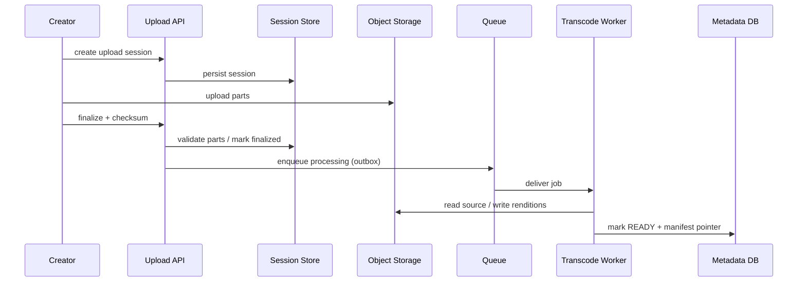

# Architecture — YouTube-Style Video Platform

## Components
- Upload API and session store: resumable upload coordination and authorization.
- Object storage: durable originals and renditions.
- Event bus/outbox: upload completion and processing lifecycle.
- Transcode workers: validation, codec ladder, thumbnails, captions and manifest generation.
- Metadata service: canonical video state, visibility and owner.
- Playback API: policy/entitlement check and signed manifest/token.
- CDN: segment delivery close to viewers; origin shielding and multi-region strategy.
- Analytics pipeline: append-only events into aggregates and recommendation features.

## Critical sequences

## Scaling
Scale playback by CDN hit ratio and edge capacity; scale workers by queue age and codec cost. Partition metadata by videoId/ownerId and avoid hot counters in the primary row. Use lifecycle policies for originals, renditions and temporary upload parts.

## Security / observability
Authorize upload ownership and visibility on every metadata/token request. Use short-lived signed URLs, malware/content checks, deletion workflows and audit logs. Monitor upload completion rate, transcode queue age, processing failure, playback startup, rebuffering, CDN hit ratio and origin egress.
