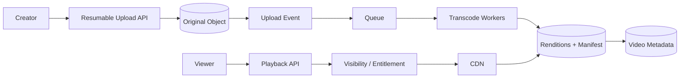
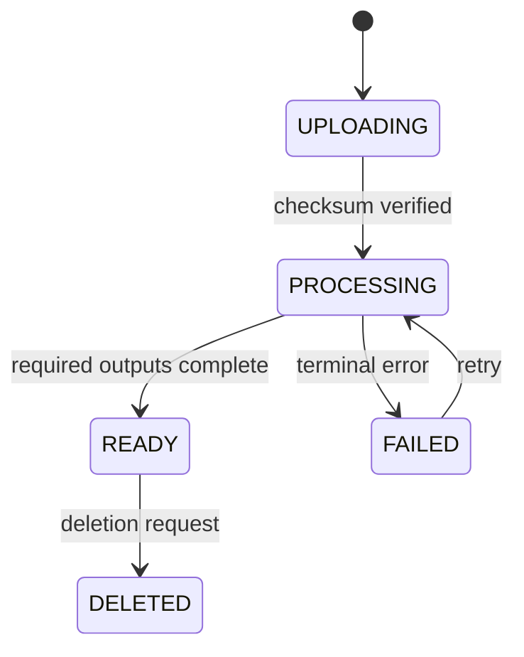

# Visual Explainer — YouTube-Style Video Platform

## Ingest vs playback

## State transition

Playback never points to an incomplete manifest. CDN serves immutable segments; control-plane metadata governs authorization and publication.
